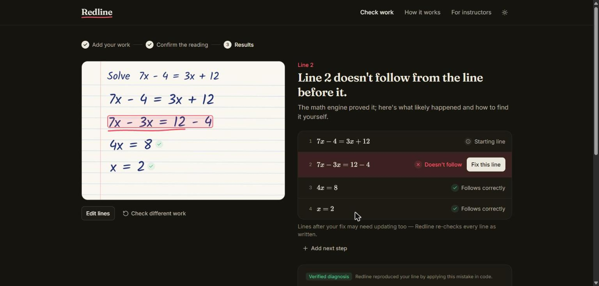
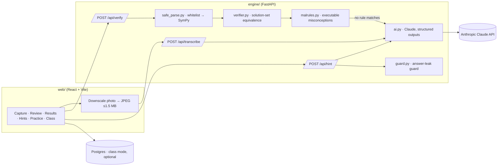

# Redline

**Finds the exact line where your math went wrong. Won't give you the answer.**

Redline reads a photo of your handwritten algebra, *proves* which line is wrong with a symbolic math engine, names the misconception behind it, and coaches you to fix it yourself — with hints that are checked by code so they can't contain the answer.

STEM2Connect AI Hackathon 2026 · Education track

- **Live demo:** https://redline-maths.vercel.app
- **Demo video:** _add the YouTube link here_
- **How it works + live accuracy numbers:** `/how-it-works` in the app, and [`eval/results.md`](eval/results.md)



---

## The problem

- In a 2025 field experiment with about 1,000 high-school students, those who practised with unrestricted GPT-4 scored **17% lower** on the unassisted exam than students who never had it (Bastani et al., *Generative AI without guardrails can harm learning*, PNAS 2025).
- Procedural errors — especially sign and distribution errors — persist from College Algebra through Calculus II (Cangelosi et al., 2013).
- When learners check their own work today they get either "wrong" (no location, no reason) or the full solution (no learning).

Learners don't need another answer machine. They need to know **where their own reasoning broke**.

## What Redline does

1. **Read** — Snap a photo (or type your steps). Claude transcribes each handwritten line into a strict math grammar and returns a box for where it sits on the photo.
2. **Confirm** — You fix anything misread, so Redline never blames you for something you didn't write.
3. **Prove** — SymPy compares the solution sets of every pair of consecutive lines. The first line that changes the solution set is the error. The LLM never decides correctness.
4. **Name** — Ten misconceptions are *executable rules*. If applying one to the previous line reproduces your line exactly, the diagnosis is **verified**. Only if none does, Claude offers a clearly labelled **AI hypothesis**.
5. **Coach** — Three hints (nudge → concept → worked example with different numbers). Every hint passes a deterministic **answer guard**; a leaking draft is rewritten once, then replaced with a built-in hint.
6. **Fix & re-verify** — Retype the line; Redline re-checks everything until "All steps verified".
7. **Practise** — Two fresh problems built to trigger the same misconception, answers checked by SymPy.
8. **Class insights** (optional) — Instructors create a class code; learners can share the *type* of mistake anonymously; the dashboard shows what to re-teach.

## How it works

> **The LLM perceives and explains. The math engine judges. Code enforces the pedagogy.**



Key design decisions (details in [docs/ARCHITECTURE.md](docs/ARCHITECTURE.md)):

| Concern | How Redline handles it |
|---|---|
| Correctness | `verifier.py` compares solution sets over ℝ with SymPy (`solveset`), with an expression-equivalence check and numeric fallback. Lost roots (÷ by x, missing ±) and extraneous roots (squaring) are classified separately. |
| Diagnosis | `malrules.py` applies buggy rewrite rules (e.g. `−k(a+b) → −ka + kb`) to the previous line and compares the result with the learner's line. A match is proof. |
| Answer leakage | The engine never sends the correct answer to the browser *or* to the model. `guard.py` still scans every hint for equations with the answer's solution set, "x is 4"-style phrases, and the corrected term. |
| Line boxes | The model's boxes are approximate, so `boxes.py` snaps each one to the nearest ink row in the photo (row projection with Pillow): the red underline lands on the handwriting even when the model is half a line off. |
| Untrusted input | `safe_parse.py` whitelists characters, caps length/exponents/numbers/nesting, and only then calls SymPy's parser with a minimal namespace. No `eval`/`exec` anywhere else. Model output is re-validated by the same parser. |
| AI outages | No key, quota, or network: typed steps, verification and built-in hints still work; the UI says so. |
| Privacy | Photos are processed in memory and never stored. Logs record route, status and timing only. Class mode stores `{class code, misconception id, topic, time}`. |

## Evaluation results

Produced by [`eval/run.py`](eval/run.py); full table and failure examples in [`eval/results.md`](eval/results.md).

| Measure | Result | Cases |
|---|---:|---:|
| Wrong line found exactly (synthetic errors) | 100% | 157 |
| False alarms on correct solutions | 0% | 15 |
| Misconception named as labelled | 91.7% | 157 |
| Errors explained by an executable rule (offline) | 93.6% | 157 |
| Hints leaking the answer **before** the guard (live, 2026-11-25) | 10% | 20 |
| Hints leaking the answer **after** the guard | 0% | 20 |
| Sample sheets: lines transcribed exactly (live) | 100% | 12 lines |
| Sample sheets: right line + misconception end to end (live) | 3/3 | 3 |

Honest caveats: the synthetic set is generated by the same rule family the engine uses, so it measures consistency rather than coverage of real student errors. The three sample sheets are rendered in handwriting fonts, not photographed — real handwritten photos still need to be added to `eval/photos/` and measured.

## Run locally

Requirements: Python 3.12+, Node 22+.

```bash
# engine
cd engine
python -m venv .venv && . .venv/bin/activate      # Windows: .venv\Scripts\activate
pip install -r requirements-dev.txt
cp .env.example .env                               # add ANTHROPIC_API_KEY (optional: offline mode without it)
uvicorn main:app --reload --port 8000

# web (second terminal)
cd web
npm install
npm run dev                                        # http://localhost:5173, proxies /api to :8000
```

Or build once and let the engine serve everything: `cd web && npm run build`, then open `http://localhost:8000`.

### Environment variables

| Variable | Where | Purpose |
|---|---|---|
| `ANTHROPIC_API_KEY` | engine | Claude API key. Unset → offline mode. |
| `AI_MODEL` | engine | Claude model id (default `claude-opus-5-5`; check with `python scripts/list_models.py`). |
| `ALLOWED_ORIGINS` | engine | CORS allow-list when the web app is served from another origin. |
| `DATABASE_URL` | engine | Postgres connection string for class mode. Unset → class mode hidden. |
| `VITE_ENGINE_URL` | web (build time) | Engine base URL if deployed separately. Empty → same origin. |

### Tests

```bash
cd engine && pytest -q                  # 227 tests: parser, verifier, rules, guard, API (recorded fixtures)
RUN_LIVE=1 pytest -q -k live            # opt-in live Claude test
cd web && npm test                      # vitest: math rendering, image utils, gate storage, API errors, hint ladder
python eval/generate.py && python eval/run.py            # synthetic evaluation (offline)
RUN_LIVE=1 python eval/run.py                            # + live hint-leak and sheet transcription
```

Manual end-to-end script: [docs/TESTING.md](docs/TESTING.md).

## API

All routes are under `/api`; errors are `{"error": {"code", "message"}}`. Interactive docs at `/api/docs`.

```bash
curl -s localhost:8000/api/health

curl -s localhost:8000/api/verify -H 'content-type: application/json' -d '{
  "lines": [{"id":"l1","ascii":"5 - 2(x - 3) = 1"},{"id":"l2","ascii":"5 - 2x - 6 = 1"}]}'
# → first_error_id "l2", misconception NEG_DIST_FIRST_ONLY, evidence "verified"

curl -s localhost:8000/api/hint -H 'content-type: application/json' -d '{
  "lines": [{"id":"l1","ascii":"5 - 2(x - 3) = 1"},{"id":"l2","ascii":"5 - 2x - 6 = 1"}],
  "error_line_id":"l2","misconception_id":"NEG_DIST_FIRST_ONLY","level":1,"lang":"en"}'

curl -s localhost:8000/api/transcribe -H 'content-type: application/json' \
  -d "{\"image_base64\":\"$(base64 -w0 web/public/samples/negative-bracket.jpg)\",\"mime\":\"image/jpeg\"}"
```

| Route | Purpose |
|---|---|
| `GET /health` | status, version, model, `ai` and `db` availability |
| `POST /transcribe` | photo → lines with boxes, confidence and parse status (6/min/IP) |
| `POST /verify` | lines → per-line status, first error, final-answer verdict, misconception |
| `POST /hint` | guarded hint, level 1–3, `en`/`hi`/`mr`/`es` (20/min/IP; never 5xx) |
| `POST /practice/generate`, `POST /practice/check` | targeted practice |
| `POST /class`, `POST /class/{code}/events`, `GET /class/{code}/summary` | class mode |

## Deploy

**Vercel (production):** `vercel.json` uses Vercel Services: the Vite app in `web/` is the frontend, and the FastAPI engine runs as one Python function (`api/index.py`) behind `/api/*`. Set `ANTHROPIC_API_KEY`, `AI_MODEL` and (optionally) `DATABASE_URL` in the project's environment variables, then:

```bash
vercel deploy --prod
vercel alias set <deployment-url> redline-maths.vercel.app   # the short URL is attached by alias
```

**Anywhere with Docker:** `docker build -t redline . && docker run -p 8000:8000 -e ANTHROPIC_API_KEY=... redline` — one container serves the API and the built app. A Render blueprint (`render.yaml`) is included for the same image.

**Class mode database:** any Postgres (production uses a free Neon project). The schema in `engine/redline/schema.sql` is applied automatically on first use (or run `python -m redline.db`).

## Privacy & safety

- For learners **18+** (in-app gate). Anthropic's commercial terms govern API inputs; don't put names or personal details in photos.
- No accounts, no tracking cookies. Photos are never written to disk or a database.
- Hints never include the answer — enforced in code, measured in the evaluation.

## Limitations

- Single-variable algebra: linear equations, brackets, fractions, quadratics, simple square roots. No inequalities, systems, calculus, geometry or word problems.
- Handwriting transcription can misread characters; the confirmation step exists for that reason.
- Ten executable misconceptions. Other errors get an AI hypothesis (labelled) or "couldn't name this mistake".
- A step that combines several operations is judged as a whole; the named misconception is the simplest rule that reproduces it.
- The in-memory rate limiter is per instance.
- Real handwritten photos haven't been evaluated yet (see Evaluation).

## AI disclosure

- **In-product AI:** Anthropic Claude (`claude-opus-5-5`) reads handwriting, suggests labelled misconception hypotheses, and words hints. It never decides correctness.
- **Development:** built with Claude Code as a coding assistant. See [AI_DISCLOSURE.md](AI_DISCLOSURE.md) for exactly what it did.

## Credits

SymPy, mpmath, FastAPI, Pydantic, Uvicorn, Anthropic Python SDK, psycopg, React, React Router, Vite, Tailwind CSS, KaTeX, Lucide icons, Fontsource (Fraunces and Inter, SIL OFL), Caveat and Kalam fonts (SIL OFL, sample sheets only), Pillow. Executable-misconception idea after *MalruleLib* (arXiv 2601.03217). Problem evidence: Bastani et al. (PNAS 2025); Cangelosi et al. (2013).

## What I learned

See [docs/LEARNING_LOG.md](docs/LEARNING_LOG.md).

## What's next

- Real handwritten photo set and published photo accuracy.
- A provider and safeguards suitable for under-18 learners, so high schoolers can use it.
- More topics: inequalities, systems, rational equations.
- A classroom pilot with an instructor.

## License

MIT — see [LICENSE](LICENSE).
